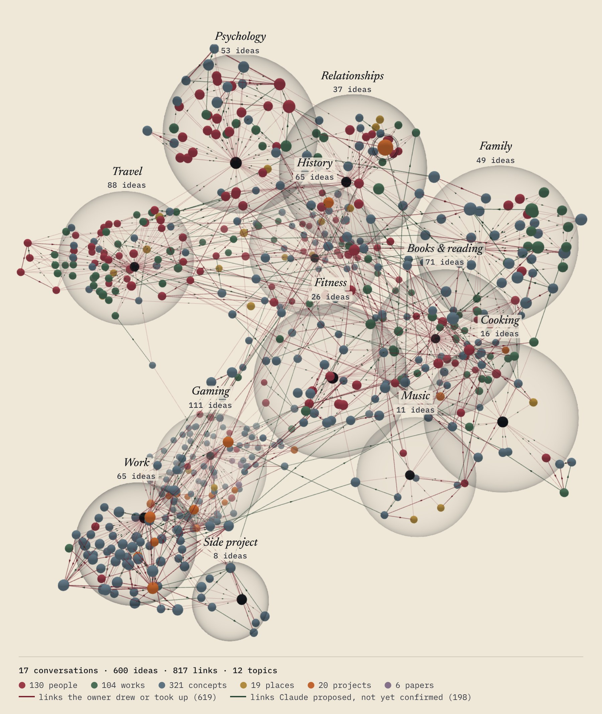
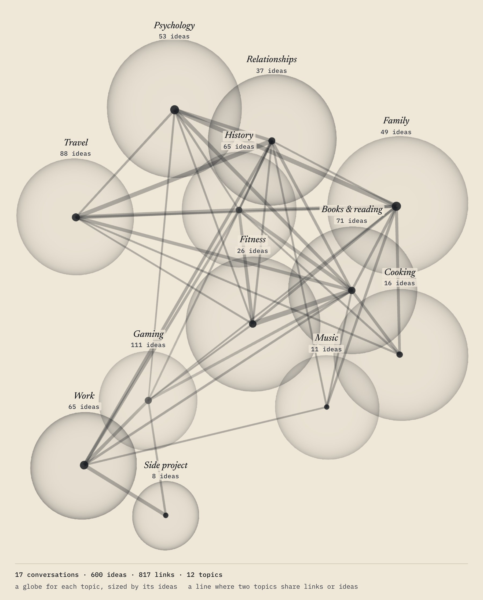
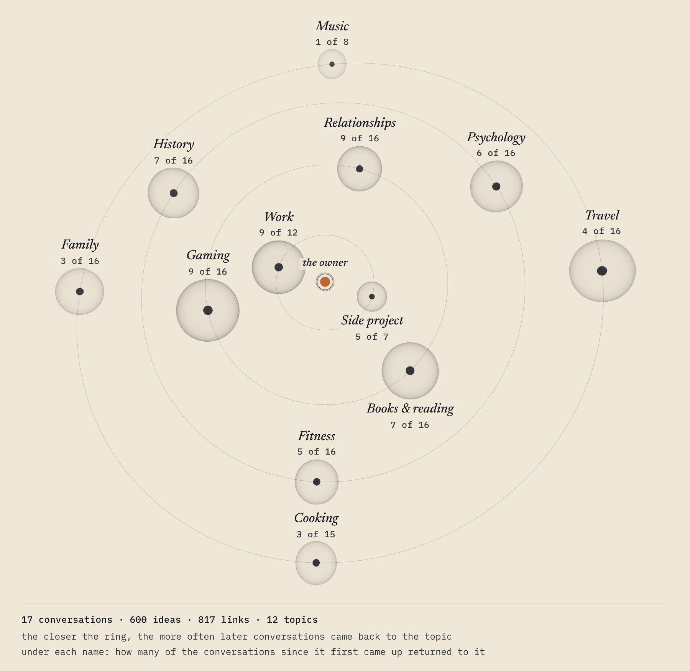

# Dialogic

A living mind map, grown one conversation at a time. You talk with Claude in a claude.ai Project about whatever you keep returning to: books, people, places, ideas, work. At the end of each conversation Claude writes a small update to the map, Claude Code merges it, and your map (an offline 3D graph of everything you've talked about, sized by how often you come back to it) is republished as a private page you can open on any device.



*A real map after 17 conversations, shown with stand-in topic names. Each dot is a person, work, place or idea that came up, sized by how much the conversations keep returning to it. A globe gathers each topic.*

This copy starts blank. Your first conversation builds it.

## What you get

The pictures show a real map after 17 conversations: 600 ideas, 817 links, 12 topics. Its shape and every number are as they are. The topic names are stand-ins and the names of the individual ideas are left off, because a map like this is personal. In your own map every topic and idea carries its own name, and each idea opens to its note.

| Topics only | Orbits |
|---|---|
|  |  |
| The ideas step back and the topics show their ties: a line wherever two of them share links or ideas. | The topics circle you. The closer the ring, the more often later conversations came back to that topic. |

Both are choices on one control in the viewer (Filters, Layout, Globes). Also in the viewer:

- **Timeline:** one tick per conversation. Replay the map growing, or spotlight what a single conversation touched.
- **Path:** the shortest chain of links between any two ideas.
- **History:** every change to the map, newest first.
- **Share:** what leads your conversations, by topic, type or field.
- **Analyze:** a reading of your map that recommends public projects to look at, run on your own Claude account.

The first time you open your map it walks you through all of this in about a minute. After that a **?** button on the map keeps a one-page guide.

## Get started (once, about half an hour)

You need a claude.ai account with Projects and Claude Code, and a GitHub account.

**First, pick how the two halves hand off to each other.** Two things travel: each map update goes from the chat to Claude Code, and the updated map comes back to the Project so the next conversation can read it.

| Setup | The update goes out | The map comes back |
|---|---|---|
| **A. Mostly at a laptop or PC** | you copy the block and paste it into Claude Code | the Project reads it from your GitHub repo; you press **Sync now** |
| **B. Mostly on a phone** | Claude saves it to an `inbox` folder in a storage service; you say "merge the inbox" | Claude Code hands you a file; you swap it into the Project |

Why two: when this was tried in November 2026, files a Project takes from GitHub did not show up in the claude.ai mobile app, so a conversation started on a phone could not see the map. If you chat on both, use B. Or test A first: add the files from GitHub at a laptop, open the Project on your phone and ask Claude whether it can see `DELTA-FORMAT.md`. If it can, A works everywhere for you. The two can also be mixed (sync for the map, an inbox for the updates).

1. **Make your own copy of this repo** on GitHub ("Use this template", or fork it). Private is fine.
2. **Create a claude.ai Project** (any name, e.g. "Mind Map").
   - **Instructions:** paste the text from `chat/PROJECT-INSTRUCTIONS.md`, everything below the line.
   - **Knowledge, setup A (GitHub sync):** in the Project's knowledge choose GitHub, pick your copy of the repo and tick three files: `chat/FIRST-CONVERSATION.md`, `docs/DELTA-FORMAT.md` and `data/knowledge/dialogic-map.txt` (blank for now). The Project has to be private to you; GitHub files can't be added to a shared one. [How the GitHub integration works](https://support.claude.com/en/articles/10167454-use-the-github-integration).
   - **Knowledge, setup B (upload):** upload `chat/FIRST-CONVERSATION.md` and `docs/DELTA-FORMAT.md`.
3. **Setup B, optional: the inbox.** In a storage service Claude connects to (Google Drive, Dropbox, OneDrive, Box or similar) make a folder `Dialogic` with a folder `inbox` inside, and turn that service's connector on in claude.ai. Map updates then go there and you just say "merge the inbox". Without it, you copy and paste the update instead. Google Drive is the service this has been run with. Another one works if its connector lets Claude create a plain text file from the chat, and list, download and move files from Claude Code.
4. **Recommended, the Hugging Face connector:** in claude.ai open [Customize → Connectors](https://claude.ai/customize/connectors) (or the [directory](https://claude.ai/connectors)) and connect Hugging Face. The map's **Analyze** reading then searches real public projects for its recommendations, instead of naming ones from memory. A free Hugging Face account works; the map only searches with it, and asks your permission the first time. [How connectors work](https://support.claude.com/en/articles/11176164).
5. **Have the first conversation** in the Project. Say hello. Claude sees it's the first one, asks what the map should call you (any alias), and either follows your lead or asks the questions itself. When it's time, say "update the map".
6. **Merge it:** open Claude Code on your copy of the repo and say "merge the first delta" (paste the block, or "merge the inbox"). Tell it which setup you chose ("the Project syncs from GitHub" or "I upload the map"); it writes that down in `SETTINGS.md`. It builds your map, publishes it and gives you the link.
7. **Finish in the Project's knowledge:**
   - **Setup A:** make sure the merge is on the branch the Project syncs, normally your default branch (if Claude Code opened a pull request, merge it). Press **Sync now**, then remove `FIRST-CONVERSATION.md` from the Project.
   - **Setup B:** delete `FIRST-CONVERSATION.md` and upload the `dialogic-map.txt` Claude Code handed you.

## After that, every conversation

- **Setup A:** talk → "update the map" → paste the block into Claude Code → once the merge is on the synced branch, **Sync now** in the Project.
- **Setup B:** talk → "update the map" → in Claude Code, "merge the inbox" (or paste) → replace `dialogic-map.txt` in the Project with the new one.

## Where to read more

- How Claude Code runs a merge: `CLAUDE.md`
- The update format both sides share: `docs/DELTA-FORMAT.md`
- The whole loop as a flowchart: `docs/WORKFLOW.md`
- How the map gets back to the Project, both ways: `docs/KNOWLEDGE-HANDOFF.md`
- Setting up a Claude Code cloud environment for this repo: `docs/ENVIRONMENT.md`

Requires Node 22 or newer. No npm install for the normal run; the graph library is prebuilt in `vendor/`.

```bash
node data/src/generate.mjs && node data/validate.mjs && node data/test/run.mjs && node build.mjs && node scripts/export.mjs
```

## Licence

MIT: see `LICENSE`. The viewer bundles three.js, 3d-force-graph and the libraries they depend on, and two fonts (Newsreader and IBM Plex Mono, under the SIL Open Font License); their notices are in `THIRD-PARTY-NOTICES.md`.
