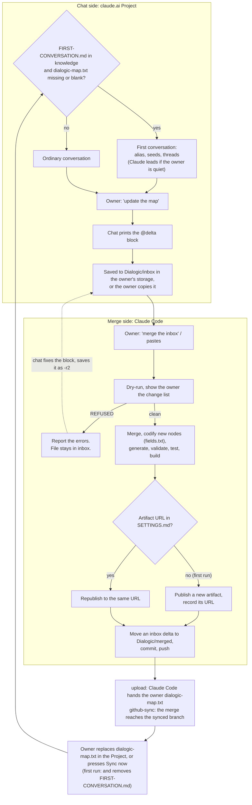

# Workflow — order of operations

One conversation, start to finish. Deltas go out through a paste or through an inbox folder in a storage service; the map comes back either through the Project's GitHub sync or as a file the owner uploads by hand (`SETTINGS.md` says which; the README explains the choice). Nothing runs on a timer: the merge side starts when the owner says "merge the inbox" or pastes a block.

## The owner's touch points per conversation

**"update the map"**, **"merge the inbox"** (or paste), then replace `dialogic-map.txt` in the Project or press **Sync now**.

## Notes

- Several conversations can pile up in the inbox before a merge. They are merged oldest first, each with its own dry-run; build, publish and commit happen once at the end.
- A corrected block is a new file with `-r2` (then `-r3`) before `.delta.txt`. The highest number wins.
- The map never travels through the storage service: text readers there can truncate long files and escape characters (Google Drive's Markdown-escapes `#`, `>` and `~`), which would corrupt ids. The chat side reads the map only from project knowledge.
- GitHub sync is a button, not a background job, and it reads one branch. With `github-sync` the map is stale in the Project until the merge is on that branch and the owner has pressed Sync now. When this was tried in November 2026, files taken from GitHub did not appear in the mobile app, so that setup is for owners who chat at a laptop.
- The Project's instructions field is pasted by hand from `chat/PROJECT-INSTRUCTIONS.md`. `docs/DELTA-FORMAT.md` is re-uploaded only when it changes (with `github-sync` it comes along on the next Sync now).

Details: the run itself is in `CLAUDE.md`; the delta contract is `docs/DELTA-FORMAT.md`; the return of the map is `docs/KNOWLEDGE-HANDOFF.md`.
