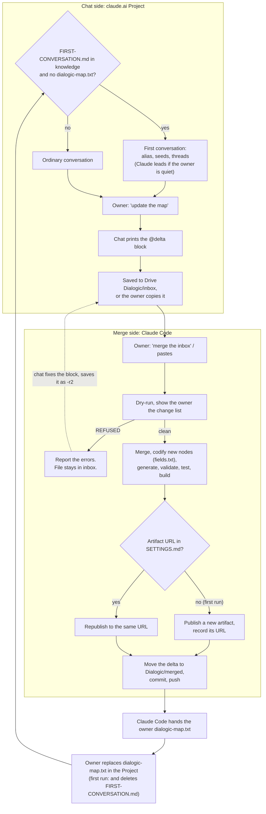

# Workflow — order of operations

One conversation, start to finish. Deltas go out through the Google Drive inbox (or a paste); the map comes back as a file the owner uploads to the Project by hand. Nothing runs on a timer: the merge side starts when the owner says "merge the inbox" or pastes a block.

## The owner's touch points per conversation

**"update the map"**, **"merge the inbox"** (or paste), replace `dialogic-map.txt` in the Project.

## Notes

- Several conversations can pile up in the inbox before a merge. They are merged oldest first, each with its own dry-run; build, publish and commit happen once at the end.
- A corrected block is a new file with `-r2` (then `-r3`) before `.delta.txt`. The highest number wins.
- The map never travels through Drive: Drive's text reader truncates long files and Markdown-escapes `#`, `>` and `~`, which would corrupt ids. The chat side reads the map only from project knowledge.
- The Project's instructions field is pasted by hand from `chat/PROJECT-INSTRUCTIONS.md`; `docs/DELTA-FORMAT.md` is re-uploaded only when it changes.

Details: the run itself is in `CLAUDE.md`; the delta contract is `docs/DELTA-FORMAT.md`; the upload is `docs/KNOWLEDGE-HANDOFF.md`.
